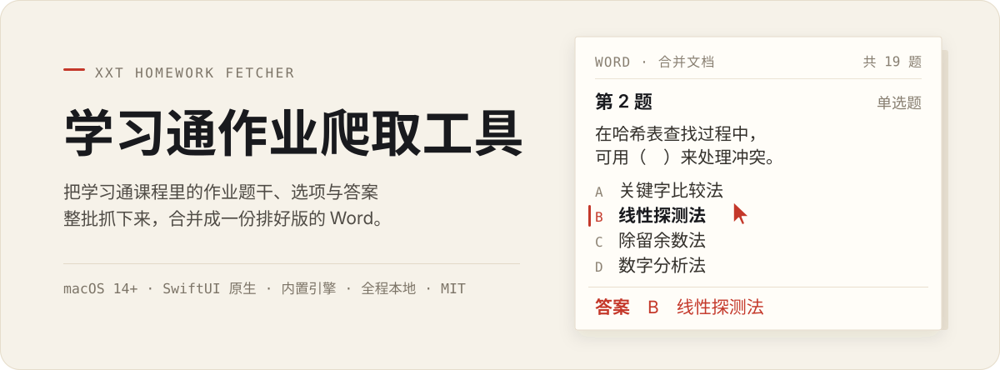
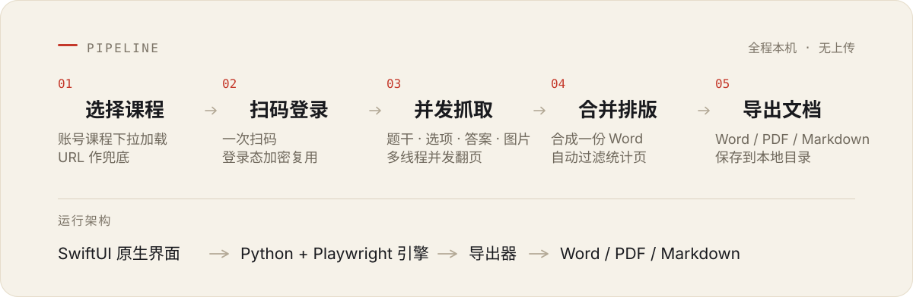

<p align="center">
  
</p>

<p align="center">
  <a href="#快速开始">快速开始</a> ·
  <a href="#功能特性">功能特性</a> ·
  <a href="#工作原理">工作原理</a> ·
  <a href="#使用方法">使用方法</a> ·
  <a href="#输出文件">输出文件</a> ·
  <a href="#常见问题">常见问题</a>
</p>

把学习通课程里的作业题干、选项、答案和图片整批抓下来，合并成一份排好版的 Word。

> **仅支持 macOS 14+（Sonoma，Apple Silicon）。** 不提供 Windows / Linux 版本。
>
> 本工具仅供个人备份**已购买的课程内容**，请勿用于侵犯他人权益或违反平台规则的用途。

## 快速开始

1. 从 [Releases](https://github.com/PYFGDUF/xxt-homework-fetcher/releases) 下载 `XxtApp.app`，解压后拖入「应用程序」。
2. 首次打开若提示无法验证开发者：右键图标 → **打开**。
3. 扫码登录学习通——只需一次，登录态加密保存后自动复用。
4. 在「选择课程」下拉中选课 → 勾选作业（默认全选）→ 点 **开始抓取**。
5. 完成后点 **打开输出目录**，结果默认在 `~/Desktop/out`。

> 应用已内置自包含 Python + Playwright 引擎，无需安装 Python 或配置 PATH。首次运行需联网下载一次浏览器内核。
>
> 若系统反复拦截，可在 **系统设置 → 隐私与安全性 → 完全磁盘访问权限** 中添加本应用。

## 功能特性

**抓取**

- 题干、选项、答案与图片一次抓全，支持题干/选项图文混排
- 自动翻页，自动过滤「智能分析」统计页
- 多线程并发抓取；图片下载到本地并嵌入文档

**导出**

- 本次所有作业自动合并为单个 Word
- 导出类型可选 **Word / Word + PDF / Markdown**

**登录与队列**

- 登录态 AES 加密存储，一次登录长期复用；启动即静默预加载课程
- 抓取过程中仍可勾选新作业，自动追加进当前队列
- 断点续传：跳过已完成作业，失败作业自动重试
- 「待修复」一键扫描并重抓答案缺失的历史作业

**界面**

- macOS 原生 SwiftUI 单页任务流
- 课程卡片显示真实封面，已结束课程置底并加遮罩
- 浅色 / 深色 / 跟随系统外观

## 工作原理

<p align="center">
  
</p>

上层是 SwiftUI 原生界面，通过本地 bridge 调用自包含的 Python + Playwright 引擎。引擎负责登录、翻页与抓取，`python-docx` / `docxcompose` 生成并合并 Word，PDF 由 Word 或 LibreOffice 导出。所有抓取与文件读写都发生在**本机**。

## 使用方法

### 选择课程

点「选择课程」下拉，从账号课程列表直接选中要抓取的课程。加载失败时展开「课程 URL」粘贴课程主页地址，正确地址以 `https://mooc2-ans.chaoxing.com/mooc2-ans/mycourse/stu` 开头，左侧能看到「作业」导航。

不要粘贴单个作业页（含 `work/view`、`exam/view`）、智能分析页（含 `analysis`）或登录页——工具会自动进入每个作业，只需要课程主页。

<details>
<summary><b>为什么这些 URL 不能用</b></summary>

| 错误类型 | 特征 | 原因 |
| --- | --- | --- |
| 单个作业 / 测验页面 | 含 `work/view`、`exam/view` | 工具会自动进入每个作业，无需手动提供 |
| 智能分析页面 | 含 `analysis` / `analyse`，或标题含「智能分析」 | 该页只有题型统计，没有题目内容 |
| 登录页 | 含 `login` | 请先登录后再复制课程页 URL |

</details>

### 操作步骤

1. **选择课程** → 自动加载作业列表，默认全部勾选，可「全选 / 清空」调整。
2. **开始抓取** → 未登录会弹出扫码界面，登录成功后长期复用。
3. **运行中追加** → 抓取时继续勾选新作业，会自动进入当前队列。
4. **查看结果** → 完成后点 **打开输出目录**，得到 Word、PDF 与图片。

### 设置（`⌘,`）

- **输出目录**：默认 `~/Desktop/out`
- **导出类型**：Word / Word + PDF / Markdown
- **重新抓取已完成作业**：开启后从头抓取，关闭时走断点续传
- **外观**：跟随系统（默认）/ 浅色 / 深色
- **存储空间**：分类统计输出目录占用（Word / 图片 / PDF / 其他），支持一键清理

其他入口：**待修复** 批量重抓答案缺失的历史作业；**清空日志** 清空界面运行日志。

### 断点续传与选择性抓取

作业列表会显示每项状态（已完成 / 失败 / 未抓取）。点「开始抓取」时只抓未抓取或失败的作业；只想抓部分时，取消勾选其余作业即可。需要从头重抓时，开启「重新抓取已完成作业」，或删除 `~/Library/Application Support/XxtApp/progress.json`。

## 输出文件

默认输出到 `~/Desktop/out`（可在设置中修改）：

| 路径 | 说明 |
| --- | --- |
| `…/课程名称_YYYYMMDD_HHMMSS/` | 每次抓取的结果目录 |
| `…/作业标题.docx` | 单个作业的 Word 文档 |
| `…/全部作业合并.docx` | 本次所有作业合并后的文档 |
| `…/images/` | 作业中下载的图片 |
| `…/.metadata/` | 原始 JSON 元数据（隐藏目录） |
| `…/debug/课程名称_YYYYMMDD_HHMMSS/` | 调试用截图与 HTML |

引擎运行数据与应用安装目录隔离，存放在 `~/Library/Application Support/XxtApp/`：

| 文件 | 说明 |
| --- | --- |
| `settings.json` | 用户配置（输出目录、外观、窗口状态等） |
| `state.json` | 登录状态（AES 加密），复用可免登录 |
| `progress.json` | 作业抓取进度（用于断点续传） |
| `cookies.txt` | 可选：手动复制的 Cookie |
| `logs/` | 分级轮转的运行日志 |

## 常见问题

**点击 `.app` 没有反应？**<br>
查看应用内「运行详情」的日志，或打开 `~/Library/Application Support/XxtApp/logs/` 排查；同时确认已授予「完全磁盘访问权限」。

**每次运行都提示权限？**<br>
在「系统设置 → 隐私与安全性 → 完全磁盘访问权限」中添加本应用。

**抓到的答案为空？**<br>
部分作业在学习通页面上本身就不显示标准答案，只能抓到学生答案或空值。可先用浏览器确认该作业确实展示了正确答案，再尝试「待修复」重抓。

**Word 里的图片显示不全？**<br>
工具会按图片原始尺寸缩放；仍有问题可在 Word 中手动调整。PDF 中的图片异常时，优先检查源 Word 是否正常。

**导出 PDF 失败？**<br>
需要以下任一环境：Microsoft Word（macOS）+ `docx2pdf`，或可用的 LibreOffice（命令行 `soffice`）。

## 注意事项

- 学习通链接中的 `enc`、`t` 等参数时效较短，提示登录失效时重新扫码即可。
- 抓取速度过快可能触发账号风控，建议保持默认间隔。
- 本工具不会上传任何数据，所有文件都保存在本机。
- 请勿分享 `state.json`，其中包含你的登录凭据。

## 更新日志

### v2.4 beta · 精简与瘦身版（当前）

- 移除「经典界面」，全应用仅保留「焕新界面」
- 清理安装包内冗余数据，体积减少约 10%
- 设置页排版优化，卡片标题层级更清晰

### v2.3 beta · 稳定性与修复版

- 修复公式/符号抓取异常：剔除页面「隐形无障碍层」乱码
- 修复偶发崩溃：重建前自动退出旧实例，避免签名失效导致的 `SIGKILL`
- 抓取提速：引擎改为多线程并发抓取
- 登录态改用 AES 加密，并独立存储密钥

### v2.2 beta · 课程体验与界面精简版

- 新增「选择课程」下拉入口，URL 输入作为兜底
- 启动静默预加载；课程卡片显示真实封面、已结束置底、入场/悬停动效
- 抓取中动态入队：运行中勾选的新作业自动追加

<details>
<summary><b>查看更早版本（v2.1.1 及以前）</b></summary>

- **v2.1.1 beta**：作业列表读取总量做完整性校验与缺漏提示；设置新增「存储空间」分类统计与一键清理；停止改为两段式确认并由运行线程安全关闭浏览器；Playwright 版本由 `requirements.txt` 单一来源驱动。
- **v2.1 beta**：总进度条平滑联动、逐题/逐图级进度上报；单作业超时截断、登录失效检测、失败重试与合并容错；空状态三步引导；来源 URL 展示开关。
- **v2.0 beta · macOS 原生版**：全新「焕新界面」单页任务流；作业即时流入带弹簧动效；主题色统一跟随；细流光加载动效；结果卡与快速操作。
- **v1.3.x · macOS 原生版**：无头扫码登录（应用内原生二维码，免下载约 340MB 组件）；设置新增登录/退出入口；作业总量校验、图片下载修复（gzip/deflate）、答案识别兼容；默认输出目录改为 `~/Desktop/out`。
- **v1.2 · macOS 原生版**：日志上下分栏、进度大字号；历史页清空按钮；修复选错课程与进度提前问题。
- **v1.1 · macOS 原生版**：全新 SwiftUI 界面（液态玻璃/材质、浅色/深色/跟随系统）取代 tkinter；内置自包含 Python/Playwright 引擎可离线分发；断点续传、选择性抓取、完成提示音与通知、图片下载嵌入、多作业合并、可选导出 PDF、内置帮助文档。
- **v1.0–v1.2（旧版 tkinter）**：学习通作业批量抓取；Word / PDF / Markdown / JSON 导出；图片本地化与嵌入；`ImageRegistry` 占位符与 `safe_filename` 加固；macOS 外观与原生菜单栏。

</details>

## 开发者

<details>
<summary><b>从源码构建</b></summary>

```bash
pip install -r requirements.txt
playwright install chromium
```

`dev.sh` 会根据引擎源码指纹判断是否需要重打包引擎，然后组装并启动：

```bash
./script/dev.sh                # 引擎源码有变→重打包；否则复用 → 组装并启动
./script/dev.sh --force        # 强制重打包引擎后再组装启动
./script/dev.sh --skip-engine  # 跳过引擎，仅编译 GUI + 组装（最快直达）
./script/dev.sh --static       # 静态检查（py_compile + pyflakes + swift build）
./script/dev.sh --test         # 引擎单测（pytest）
./script/dev.sh --precheck     # 静态检查 + 单测全过后再组装启动
```

产物在 `xxt-swift/dist/XxtApp.app`。

技术栈：SwiftUI · Python 3 + Playwright · python-docx / docxcompose · docx2pdf / LibreOffice · Pillow。

</details>

## 许可证

本项目基于 [MIT 许可证](LICENSE) 开源，仅供个人备份已购买课程内容使用。仅支持 macOS 平台。
